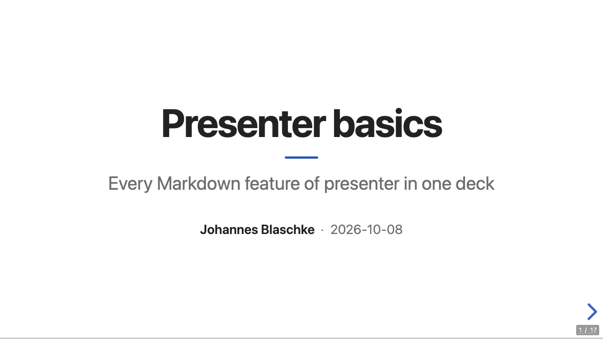
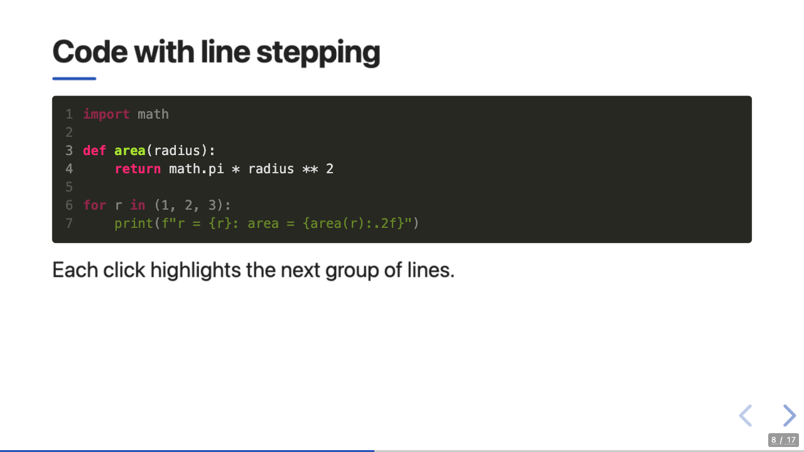
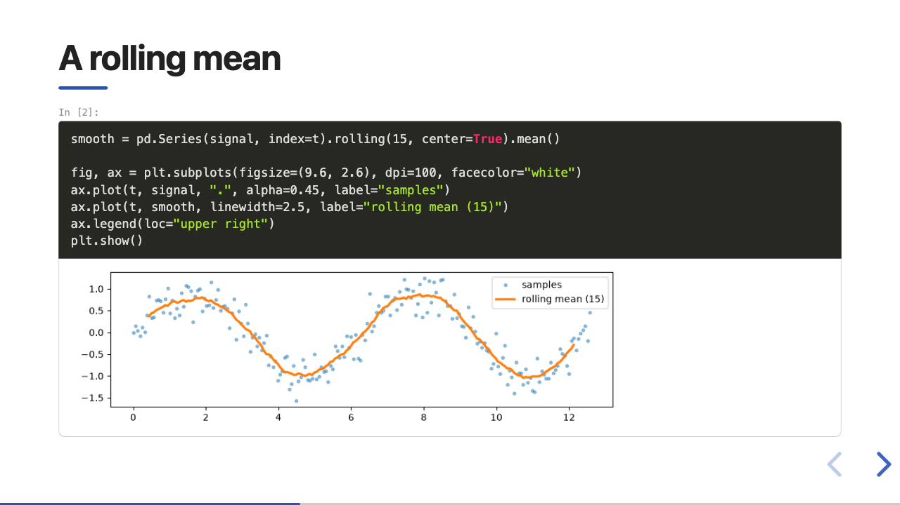

# presenter

Write slides in Markdown or a Jupyter notebook, and get a
[reveal.js](https://revealjs.com) presentation in one HTML file that works offline.
presenter is a single binary: while you write, it shows the deck in your browser and
updates it on every save of the slides, their images or the theme, so you can shape the
look as you go instead of configuring it once.



## In 30 seconds

```sh
presenter init talk                 # a deck, a presenter.toml and a small theme
cd talk
presenter serve slides.md --open    # live preview; edit slides.md and watch (Ctrl-C stops)
presenter build slides.md           # Wrote dist/slides.html (6 slides, 1.8 MB)
```

`slides.md` is Markdown with a few conventions:

````markdown
---
title: Rust for data people
author: J. Blaschke
---

# Rust for data people {layout=title}

---

## Agenda

:::fragment
Appears on the next click.
:::

--- {background="#111" transition=fade}

## Code

```python {lines="1|3"}
import polars as pl

df = pl.read_csv("data.csv")
```
````

## Features

- **One self-contained file.** reveal.js, the theme, fonts, images and (for decks with
  math) KaTeX are inlined; the deck opens from disk without a network. A site directory
  (`--site`) is available for very large decks.
- **Live preview.** `presenter serve` swaps a changed stylesheet without reloading the page,
  replaces the slides on any other change while staying on the current slide, and shows
  build errors in an overlay with file, line and source.
- **Markdown for slides.** `---` and `--` separators, or slides at headings as in pandoc;
  `{#id .class key=value}` attributes; `:::` blocks for notes, fragments and columns; code
  with highlighted line steps; `$…$` math; GitHub tables, alerts, footnotes and task lists;
  reveal.js Markdown-plugin comments.
- **Jupyter notebooks.** Slide types and tags work as with `nbconvert --to slides`; saved
  outputs render: HTML, DataFrames, images, SVG, LaTeX, Markdown, streams and tracebacks
  with ANSI colours. The notebook is never run, and no Python is needed.
- **Themes as files.** A theme is a directory of Jinja templates, CSS or SCSS and assets that
  extends the built-in theme and overrides what it needs: tokens, layouts or templates.
  SCSS compiles in the binary and can build on reveal.js's own theme template.
- **Checks.** `presenter check` finds separators that did not split, missing images,
  unknown layouts and notebooks that were never run, with `--deny-warnings` for CI.
- **PDF and PowerPoint export** through headless Chrome or Chromium. The `.pptx` has one
  editable slide per slide and fragment step: text boxes, tables, images and backgrounds
  where the theme put them, with the speaker notes in the notes pane.
- **Deterministic builds.** The same inputs give the same HTML, byte for byte.

| Code with line steps | A notebook cell with its plot |
|---|---|
|  |  |

## Install

**Release binaries:** each release on GitHub has archives for macOS (Apple silicon, Intel)
and Linux (x86_64, arm64). Unpack yours and put `presenter` on your `PATH`; see
[Getting started](docs/guide/getting-started.md#install) for the details, including
macOS's quarantine.

**From source**, with Rust 1.89 or newer, in a checkout:

```sh
cargo install --path .
```

Either way, the binary needs nothing else at run time; `presenter export pdf` and
`presenter export pptx` also need Chrome or Chromium.

## Documentation

The [user guide](docs/guide/README.md) is in the repository's `docs/guide/` directory. The
release archives do not include it or the pictures, so this README's links work on the
project's GitHub page or in a checkout:

- [Getting started](docs/guide/getting-started.md): install, create, preview, build, export
  to PDF or PowerPoint.
- [Writing slides](docs/guide/authoring.md): the Markdown dialect, and `presenter check`.
- [Notebooks](docs/guide/notebooks.md): slide types, tags, outputs, running the notebook.
- [Themes](docs/guide/themes.md): tokens, layouts, templates, SCSS, the live-reload loop.
- [Configuration](docs/guide/configuration.md): every setting and its default.
- [Command line](docs/guide/cli.md): every command and flag.

Examples: [`examples/basic`](examples/basic/README.md) (the Markdown features),
[`examples/notebook`](examples/notebook/README.md),
[`examples/headings-mode`](examples/headings-mode/slides.md) and
[`examples/custom-theme-scss`](examples/custom-theme-scss/README.md). The built-in theme's
tokens and markup are documented in
[`assets/themes/default/README.md`](assets/themes/default/README.md).

Changes are listed in the [changelog](CHANGELOG.md). Contributors: the design is in
[PLAN.md](PLAN.md), the contracts between modules in [`docs/spec/`](docs/spec/),
and the release process in [`docs/dev/release.md`](docs/dev/release.md).

## License

presenter is licensed under the [MIT license](LICENSE).

The binary embeds the work of others, and the decks it builds include the parts they use.
Each comes with its license file in [`assets/vendor/`](assets/vendor/), and
[`VERSIONS.toml`](assets/vendor/VERSIONS.toml) records the versions and sources:

| Work | License | Where |
|---|---|---|
| reveal.js 6.0.2 | MIT | `assets/vendor/reveal/LICENSE` |
| KaTeX 0.19.0 | MIT | `assets/vendor/katex/LICENSE` |
| highlight.js 11.11.1, bundled in reveal.js's highlight plugin | BSD-3-Clause | `assets/vendor/highlight.js/LICENSE` |
| highlightjs-line-numbers.js 2.8.0, in the highlight plugin | MIT | `assets/vendor/highlightjs-line-numbers.js/LICENSE` |
| marked 17.0.5, in reveal.js's notes plugin | MIT | `assets/vendor/marked/LICENSE.md` |
| fitty 2.4.2, in reveal.js itself | MIT | `assets/vendor/fitty/LICENSE` |
| Source Sans Pro and League Gothic, the fonts of reveal.js's themes | SIL Open Font License 1.1 | `assets/vendor/reveal/css/theme/fonts/*/LICENSE*` |

The Rust crates compiled into the binary keep their own licenses. Release archives carry
all of these notices in `THIRD-PARTY-LICENSES/`.
