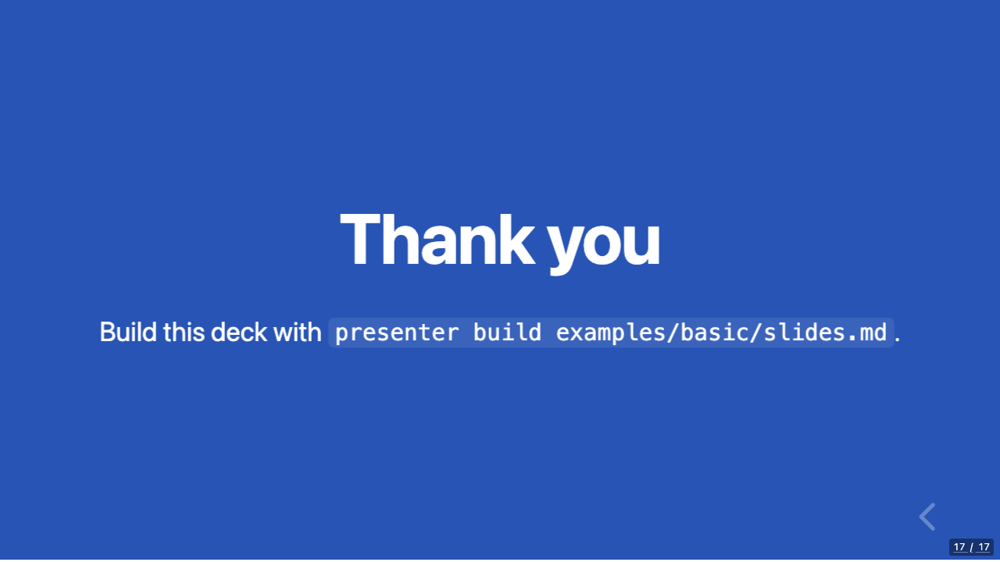
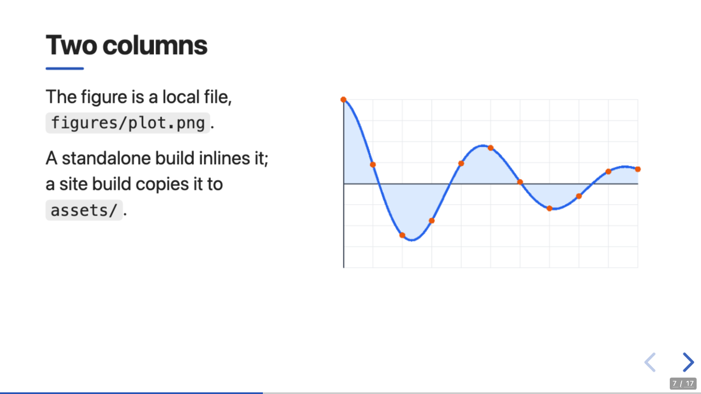
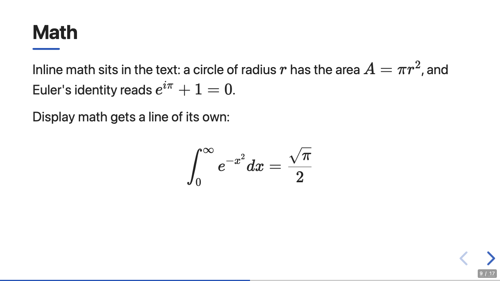
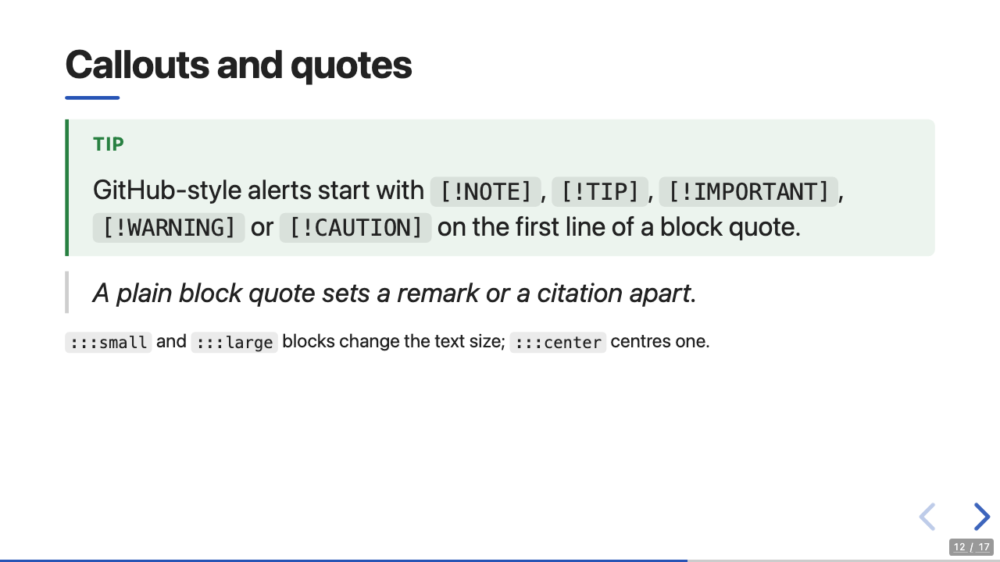

# Writing slides

A deck is one Markdown file. presenter reads CommonMark with the GitHub extensions
(tables, task lists, strikethrough, autolinks, footnotes, alerts) and description lists,
and adds a few conventions for slides. Most features on this page appear in
[`examples/basic/slides.md`](../../examples/basic/slides.md); build it to see them.

```sh
presenter build examples/basic/slides.md
```

## A deck in one screen

````markdown
---
title: Rust for data people
author: J. Blaschke
---

# Rust for data people {layout=title}

---

## Agenda

- Why Rust
- Tooling

--

## A slide below the agenda

:::fragment
Appears on the next click.
:::

--- {background="#111" transition=fade}

## Code

```python {lines="1|3"}
import polars as pl

df = pl.read_csv("data.csv")
```

:::notes
Mention compile times.
:::
````

## Front matter

An optional YAML block at the very top sets the deck's metadata:

```yaml
---
title: Rust for data people        # the page <title>
subtitle: A field report           # shown by the title layout
author: J. Blaschke                # shown by the title layout
date: 2026-10-08                   # shown by the title layout, as written
description: Notes from a talk     # <meta name="description">
lang: en                           # <html lang>
theme: ./theme                     # a built-in theme name or a theme directory
reveal:                            # reveal.js options for this deck
  transition: fade
slides:                            # also markdown:, math: and notebook:
  incremental_lists: true
venue: PyData Berlin               # anything else: for templates (meta.vars.venue)
---
```

- `reveal:`, `slides:`, `markdown:`, `math:` and `notebook:` override the tables of the same
  name in `presenter.toml` for this deck ([Configuration](configuration.md#front-matter)).
  Unknown keys inside them are errors with a "did you mean" hint.
- Every other key is free: themes read it as `meta.vars.<key>`. The scaffold that
  `presenter init` writes shows an `event:` line on the title slide this way.
- The block is YAML 1.2. A value with `: ` in it needs quotes
  (`title: "Rust: the good parts"`; presenter says so when you forget), and `yes`/`no`
  are strings, not booleans. Indent with spaces.
- In YAML, `#` starts a comment, so a Markdown heading that ends up inside the block (the
  closing `---` is missing) disappears silently. presenter warns about blocks that look
  like that.

## Slides

| Line | Starts |
|---|---|
| `---` (also `***` or `___`) | the next horizontal slide |
| `--` | a vertical slide, below the current one (reveal's down arrow) |
| `--- {…}` or `-- {…}` | a slide with [attributes](#slide-attributes) |

```markdown
## Results

--

## Results in detail

---

## Next topic
```

- Content before the first separator is the first slide.
- Two separators in a row make an empty slide.
- Separator lines inside fenced code, lists, block quotes and directives are content, not
  separators. So a code block may show a `---` line safely.
- A `---` closes a vertical stack; the next `--` opens a new one under the new slide.

### Leave a blank line before `--` and `---`

In Markdown, a line of `-` directly under a line of text underlines that text into a
heading (a setext heading). So this is one slide with a heading "Some text", not two
slides:

```markdown
Some text
--
```

Put a blank line before the separator. `presenter check` finds every such line:

```text
slides.md:2: warning: `--` under a line of text turns that text into a heading (setext), so no slide starts here; put a blank line before it to start a vertical slide
```

The same applies to `---` after text, to separators indented four spaces (code), and to
separators inside a list or a directive. `check` names the reason for each.

## Slide attributes

Attributes go in braces, pandoc-style: `{#id .class key=value key="quoted value"}`. They
reach a slide in three ways:

```markdown
--- {background="#0f172a" transition=zoom}

## A dark slide {#dark .center layout=default}

<!-- .slide: data-state="intro" -->
```

1. After the separator that opens the slide.
2. In a `<!-- .slide: … -->` comment among the first lines of the slide, or right under its
   first heading (the reveal.js Markdown plugin's form).
3. After the slide's first heading: the attributes move from the heading to the slide, and
   the heading stays clean. `#id` becomes the slide's id, so `[link](#/dark)` jumps there.

Later sources win for the same key (heading over comment over separator); classes add up.
Only the first visible element of a slide may carry slide attributes (HTML comments and
`:::notes` blocks before it do not count); presenter warns when `layout=` or
`background=` sit on another heading and are not applied.

### Keys

| You write | presenter emits | Effect |
|---|---|---|
| `#id` | `<section id>` | link target `#/id` |
| `.name` | a class on `<section>` | your CSS; `.center` centres the slide, `.incremental` steps through lists |
| `layout=title` | the theme layout `title` | see [Layouts](#layouts) |
| `background=#123` or `background=navy` or `background="rgb(…)"` | `data-background-color` | a colour |
| `background=figures/bg.png` | `data-background-image` | an image, bundled like other images |
| `background-image`, `background-video`, `background-iframe`, `background-size`, `background-position`, `background-repeat`, `background-opacity`, `background-color`, `background-gradient`, `background-transition`, `background-video-loop`, `background-video-muted`, `background-interactive` | `data-` + key | [reveal backgrounds](https://revealjs.com/backgrounds/) |
| `transition`, `transition-speed`, `auto-animate`, `auto-animate-easing`, `auto-animate-duration`, `auto-animate-unmatched`, `auto-animate-id`, `auto-animate-restart`, `visibility`, `state`, `timing`, `autoslide`, `menu-title` | `data-` + key | reveal per-slide options, e.g. `transition=zoom`, `visibility=hidden` |
| `data-…`, `aria-…` | as written | anything reveal or your scripts read |
| anything else | as written | `presenter check` warns "unknown slide attribute" |

Local files in `background=`, `background-image=`, `background-video=` and
`background-iframe=` are found next to the deck and embedded like images.

### Writing values

- `key=value` runs to the next space; quote values with spaces: `key="two words"` or
  `key='two words'`.
- A value may contain `#`, `/`, `|` and other punctuation unquoted:
  `{background=#222}`, `{background=figures/bg.png}`, `{lines=1|3}`.
- Separate items with spaces, not commas: `{.dark .center}`, not `{.dark, .center}`.
- A key without a value (`{auto-animate}`) works only after a separator and in
  `<!-- .slide: -->`. On a heading write `auto-animate=""`.
- A brace block presenter cannot read as attributes stays in the text, and presenter warns
  (`unparsed-attr-block`) with the reason.

### Layouts

The built-in theme has four layouts; themes can add more ([Themes](themes.md#layouts)).

| Layout | Use it for |
|---|---|
| `default` | everything else: heading at the top, content left-aligned |
| `title` | the title slide: centred heading, then `subtitle`, `author` and `date` from the front matter |
| `section` | a section divider: big centred heading on the accent colour |
| `blank` | no padding; a lone image, video or iframe fills the slide |

| `# Presenter basics {layout=title}` | `# Thank you {layout=section}` |
|---|---|
|  |  |

An unknown layout renders like `default`, and `presenter check` warns.

## Directives

A line `:::name` opens a block and a line `:::` closes it. Without special meaning, the
block becomes `<div class="name">`.

| Directive | Result |
|---|---|
| `:::notes` | speaker notes, not shown on the slide ([Speaker notes](#speaker-notes)) |
| `:::fragment` | appears on the next click; add reveal effects and an order: `:::fragment fade-up index=2` |
| `:::columns` … `:::column` | side-by-side columns (CSS grid); `:::columns widths="2fr 3fr"` sets their widths |
| `:::center`, `:::small`, `:::large` | centred text, smaller or larger text (built-in theme) |
| `:::anything a b key=v` | `<div class="anything a b" data-key="v">`, for your theme's CSS |

To nest directives, make the **outer** fence longer than the inner ones:

```markdown
::::columns widths="2fr 3fr"
:::column
The figure is a local file.
:::
:::column

:::
::::
```



With fences of the same length, the first `:::` closes the outer block, and the outer
block's own `:::` then opens an empty one that swallows everything up to the next `:::`
line (separators included); presenter warns about it.

Pandoc's form works too: `::: {.fragment .fade-up}` is `:::fragment fade-up`,
`::: {#intro .note}` adds `id="intro"`, and `::: {.notes}` is `:::notes`.

An opening line with a colon in it, such as `:::box src=https://example.com`, opens no
directive (presenter warns); write the colon as `&#58;`.

### Fragments

```markdown
:::fragment
Appears first.
:::

:::fragment fade-up index=3
Appears last, though written second.
:::

Inline: <span class="fragment highlight-red">this turns red</span>.
```

Effects are reveal's fragment classes: `fade-out`, `fade-up`, `fade-down`, `fade-left`,
`fade-right`, `fade-in-then-out`, `fade-in-then-semi-out`, `grow`, `shrink`, `strike`,
`highlight-red`, `highlight-green`, `highlight-blue`, and the
[others reveal lists](https://revealjs.com/fragments/). `index=N` (0, 1, 2, …) sets the
order.

### Incremental lists

To make list items appear one at a time, set `incremental_lists = true` under `[slides]`
in `presenter.toml` (or `slides: {incremental_lists: true}` in the front matter), or add
`.incremental` to a slide. `.no-incremental` on a slide turns it off there. Only the
top-level lists of a slide step; nested items come with their parent.

```markdown
## Plan {.incremental}

- first
- second
```

## Code

Fenced code is highlighted by highlight.js in the browser. The language goes first in
the info string, attributes after it:

````markdown
```python {lines="1|3-4|6-7"}
import math

def area(radius):
    return math.pi * radius ** 2

for r in (1, 2, 3):
    print(f"r = {r}: area = {area(r):.2f}")
```
````


| Attribute | Effect |
|---|---|
| `lines="1-2\|4"` | line numbers, and step through the highlighted lines on each click (`\|` separates steps) |
| `.numbered` | line numbers, no steps |
| `start=10` | number from 10 |
| `trim=false` | keep leading and trailing blank lines |
| `escape=false` | the code is HTML: write `<mark>` and other tags to emphasise parts |
| `.plain` | no highlighting |
| `#id`, `.class` | on the `<pre>` element (`.r-stretch` makes the block fill the height left on the slide) |
| `key=value` | `data-key="value"` on the `<code>` element |

Without a language, highlight.js guesses. Long code blocks scroll; the built-in theme caps
them at `--p-code-max-height` ([tokens](../../assets/themes/default/README.md#tokens)).

## Math

`$…$` is inline math and `$$…$$` display math, rendered with KaTeX (bundled; no network
needed). A fenced block with the language `math` is display math too. Write `\$` for a
literal dollar sign.

```markdown
A circle of radius $r$ has the area $A = \pi r^2$.

$$\int_0^\infty e^{-x^2} dx = \frac{\sqrt{\pi}}{2}$$
```



KaTeX is included only in decks that have math (`[math] enabled = "always"` forces it).
Macros and other KaTeX options go in `presenter.toml`:

```toml
[math]
katex_options = { macros = { "\\R" = "\\mathbb{R}" } }
```

## Images, video and embedded pages

```markdown

{width=50%}
<video src="clip.mp4" controls></video>
<iframe src="figures/embed.html" width="900" height="360"></iframe>
```

- Relative paths are relative to the deck's file. presenter embeds those files: a
  standalone build inlines them, a site build copies them to `assets/`. This covers
  Markdown images, `src` and `poster` in raw HTML, and the background attributes.
- A file that does not exist fails `presenter build`, is a warning in `presenter serve`
  (the browser shows a broken image), and a finding of `presenter check`.
- Names must match the file's letter case exactly. macOS finds `Plot.png` for `plot.png`,
  Linux does not; presenter warns when only the case matches.
- Remote URLs (`https://…`) and absolute paths (`/img.png`) are left as they are and never
  downloaded. Links (`[slides](handout.pdf)`) are left as they are too, not embedded.
- A Markdown image sits inside a paragraph. For an image that fills the slide, use a slide
  with `layout=blank` holding only the image, or `background=`.

## Tables, alerts, footnotes, task lists

GitHub's syntax works as on GitHub:

```markdown
| Line | Starts |
|:--|:--|
| `---` | a horizontal slide |

> [!TIP]
> Alerts are `[!NOTE]`, `[!TIP]`, `[!IMPORTANT]`, `[!WARNING]` and `[!CAUTION]`.

presenter renders slides with reveal.js[^reveal].

[^reveal]: https://revealjs.com

- [x] write the slides
- [ ] rehearse
```



Each slide lists its own footnotes at its bottom, so define a footnote on the slide that
uses it; presenter warns when the definition is elsewhere.

## Speaker notes

```markdown
## Results

The numbers.

:::notes
Mention that the second run used the cache.
:::
```

Notes go in `:::notes` blocks anywhere on the slide (several are joined). As in reveal's
Markdown plugin, a paragraph starting with `Note:` also starts the notes: it and everything
after it on the slide become notes. Press <kbd>S</kbd> in the browser for the speaker view.

## Raw HTML

HTML passes through unchanged, so every reveal.js feature is reachable:

```markdown
<div class="r-stack">
  
  
</div>

<span class="fragment highlight-red">click me</span>
```

## Headings mode

Pandoc and Quarto users write decks without separator lines: headings start the slides.
Turn this on in `presenter.toml` (or `slides: {split: headings}` in the front matter):

```toml
[slides]
split = "headings"
slide_level = 2        # the level of an ordinary slide
```

- With `slide_level = 2`, a `#` heading starts a section (a horizontal slide), and each `##`
  heading under it starts a vertical slide below the section. `###` and deeper are content.
- A `##` heading without a `#` section above it starts a horizontal slide. So a deck
  of only `##` slides is a plain row of slides.
- `slide_level = 1` makes every `#` heading an ordinary slide.
- `---` and `--` lines still work, so a deck can move from one style to the other
  gradually; a `---` ends the current section.
- Attributes, layouts and notes work as above: `# Results {layout=section}`.

[`examples/headings-mode`](../../examples/headings-mode/slides.md) shows all of this.

## reveal.js Markdown habits

Decks written for reveal.js's Markdown plugin keep working:

| Habit | presenter |
|---|---|
| `<!-- .slide: data-background="#f00" class="dark" -->` | slide attributes ([above](#slide-attributes)) |
| `- item <!-- .element: class="fragment" -->` | attributes for the element before the comment (here the `<li>`), or the enclosing element; `class` values are added |
| `Note:` paragraph | speaker notes |
| `data-background="image.png"` | treated as `data-background-image`, and the file is embedded |

## Check a deck

`presenter check` reads a deck (or several) without building it and reports likely
mistakes, one per line:

```sh
presenter check slides.md
```

```text
slides.md:4: warning: `--` under a line of text turns that text into a heading (setext), so no slide starts here; put a blank line before it to start a vertical slide
slides.md:21: warning: image `nothere.png` not found (looked for /home/me/talk/nothere.png)
slides.md:23: warning: unknown directive 'include': including files is not implemented, so nothing is included (the directive renders as a plain <div>)
```

It finds, among others:

- separator lines that did not start a slide, with the reason;
- empty slides and duplicate slide ids;
- unknown layouts, unknown slide attributes and attribute blocks it could not read;
- directive mistakes (a bare `:::` opener, a `:` in the opening line, `:::include`);
- missing images and file names that match only in letter case;
- front matter that probably swallowed a slide;
- problems with the theme that would fail the build;
- for notebooks: missing outputs, widgets and scripts in outputs ([Notebooks](notebooks.md#check-a-notebook)).

The exit code is 0 when there are only warnings, and 1 when there is an error, or any
finding at all with `--deny-warnings` (for CI). `--format json` prints the findings as JSON
with `level`, `code`, `message`, `path`, `line` and `cell`.
