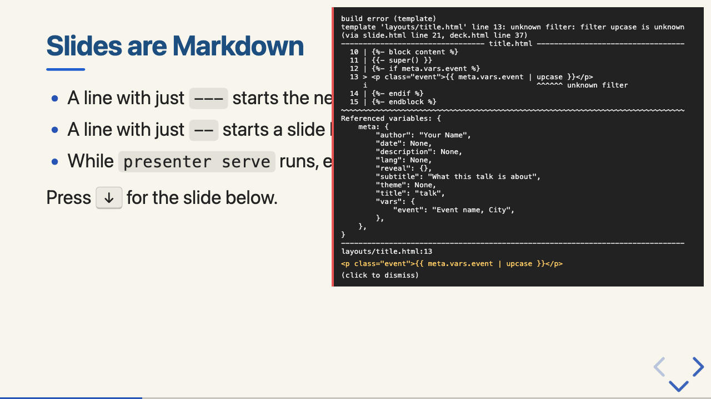

# Getting started

This page takes you from nothing to a finished deck: install presenter, create a
presentation, preview it while you edit, then build the HTML file and a PDF.

## Install

presenter is one binary. reveal.js, KaTeX, the built-in theme and the Sass compiler are
inside it, so it needs no Node.js, Python or network access.

### From a release archive

Each release on GitHub has an archive for macOS (Apple silicon and Intel) and Linux
(x86_64 and arm64, glibc):

| Platform | Archive |
|---|---|
| macOS, Apple silicon | `presenter-v0.1.0-aarch64-apple-darwin.tar.gz` |
| macOS, Intel | `presenter-v0.1.0-x86_64-apple-darwin.tar.gz` |
| Linux x86_64 | `presenter-v0.1.0-x86_64-unknown-linux-gnu.tar.gz` |
| Linux arm64 | `presenter-v0.1.0-aarch64-unknown-linux-gnu.tar.gz` |

Download yours and `SHA256SUMS` from the project's GitHub Releases page (the names carry
the version, here 0.1.0), then check, unpack and install it; here for Apple silicon, into
`~/.local/bin`:

```sh
shasum -a 256 -c --ignore-missing SHA256SUMS      # Linux: sha256sum -c --ignore-missing SHA256SUMS
tar -xzf presenter-v0.1.0-aarch64-apple-darwin.tar.gz
mkdir -p ~/.local/bin
cp presenter-v0.1.0-aarch64-apple-darwin/presenter ~/.local/bin/
```

`~/.local/bin` must be on your `PATH`. The archive also holds `LICENSE`, `README.md` and
`THIRD-PARTY-LICENSES/`, the notices of the code built into the binary. It does not hold
this guide or the examples: the README's links and pictures point into the repository, so
read them on the project's GitHub page or in a checkout.

The binaries are not signed. macOS quarantines files downloaded with a browser, and
Gatekeeper then refuses to run the binary. If that happens, remove the mark once:

```sh
xattr -d com.apple.quarantine ~/.local/bin/presenter
```

Files downloaded with `curl` are not quarantined.

### From source

With Rust 1.89 or newer ([rustup.rs](https://rustup.rs)), in a checkout of the repository:

```sh
cargo install --path .
```

This builds a release binary and copies it to `~/.cargo/bin/presenter`.

### Check the installation

```sh
presenter --version
```

It prints the version and the build, for example `presenter 0.1.0 (v0.1.0)`.

## Create a presentation

```sh
presenter init talk
```

```text
Created a presentation in talk:
  presenter.toml  settings: every option, with its default
  slides.md       the deck: six example slides
  theme/          the look: a theme that extends the built-in "default" theme
  README.md       how to preview, build and restyle the presentation
  .gitignore      keeps the build output (dist/) out of git

Next steps:
  cd talk
  presenter serve slides.md    # live preview; every save updates it
  presenter build slides.md    # writes dist/slides.html
```

`presenter init --notebook talk` starts from a notebook (`slides.ipynb`) instead, and
`--full-theme` copies the whole built-in theme into `theme/` instead of a small child
theme. You do not need `init` at all: any `.md` file is a deck.

## Preview while you edit

```sh
cd talk
presenter serve slides.md
```

presenter prints `Serving http://127.0.0.1:3000/`. Open that address (or start with
`--open`). Now edit `slides.md` and save: the browser shows the change and stays on the
slide you are looking at. Saving `theme/styles/theme.css` swaps the stylesheet without even
reloading the page. If something does not build, an overlay in the page says what and
where, and the last good version of the deck stays visible:



Stop the server with Ctrl-C. `--port 0` picks a free port when 3000 is taken.

In the browser, these reveal.js keys help:

| Key | Does |
|---|---|
| <kbd>→</kbd> <kbd>←</kbd> <kbd>↓</kbd> <kbd>↑</kbd>, <kbd>Space</kbd> | next and previous slide, down and up a vertical stack |
| <kbd>S</kbd> | the speaker view: notes, the next slide and a timer |
| <kbd>Esc</kbd> | an overview of all slides |
| <kbd>F</kbd> | full screen |

## Build the deck

```sh
presenter build slides.md
```

```text
Wrote dist/slides.html (6 slides, 1.8 MB)
```

`dist/slides.html` is the whole presentation: reveal.js, the theme, fonts, images and (when
the deck has math) KaTeX are inside it. Open it from disk, mail it, or put it on any web
server. `dist/` is next to the deck; `-o` writes elsewhere.

For a very large deck (many big images), `--site` writes a directory instead:
`dist/slides/index.html` plus an `assets/` directory with the files it loads.

`presenter build slides.md --watch` rebuilds the file on every save without a server.

## Export a PDF

```sh
presenter export pdf slides.md
```

```text
Wrote dist/slides.pdf (9 pages, 167.4 kB)
```

This needs Google Chrome or Chromium (Edge and Brave work too). presenter finds it in the
usual places; otherwise name it with `--chrome PATH` or the `CHROME_PATH` environment
variable. Each fragment step gets its own page (that is why six slides make nine pages);
`pdfSeparateFragments = false` under `[reveal]` in `presenter.toml` prints each slide once.

## Find mistakes

```sh
presenter check slides.md
```

`check` reads the deck without building it and prints a warning for each likely mistake:
a `--` line that did not start a slide, a missing image, an unknown layout, a notebook that
was never run. It prints nothing for a clean deck. [Writing slides](authoring.md#check-a-deck)
lists what it finds.

## Next

- [Writing slides](authoring.md): everything you can write in `slides.md`.
- [Notebooks](notebooks.md): slides from a Jupyter notebook.
- [Themes](themes.md): change the look, from one colour to your own templates.
- [Configuration](configuration.md) and [Command line](cli.md): every setting and flag.
