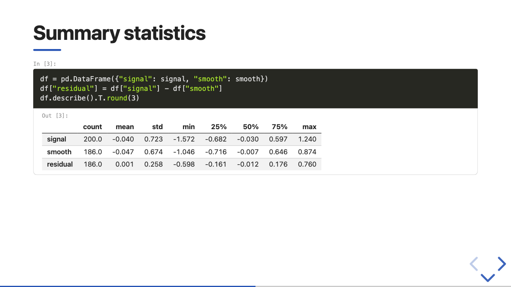

# Notebooks

A Jupyter notebook (`.ipynb`, nbformat 4) is a deck as well. presenter follows the
conventions of `jupyter nbconvert --to slides`, so a notebook already set up for
nbconvert builds unchanged, and it renders the outputs saved in the notebook: it does not
run any code and needs no Python.

```sh
presenter build examples/notebook/analysis.ipynb
presenter serve examples/notebook/analysis.ipynb
```

`presenter serve` rebuilds whenever the notebook is saved, so keep it running next to
Jupyter. [`examples/notebook`](../../examples/notebook/README.md) is an executed example
with a plot, a DataFrame, math and a traceback. `presenter init --notebook talk` starts a
new presentation from a small notebook.


## Slide types

Each cell's slide type says where it goes. In JupyterLab, select the cell, open
**View → Property Inspector** (<kbd>Ctrl</kbd>/<kbd>Cmd</kbd>+<kbd>Shift</kbd>+<kbd>U</kbd>) in
the right sidebar and pick its **Slide Type** under Common Tools. In the file it is
`metadata.slideshow.slide_type`.

| Slide Type | JSON value | Effect |
|---|---|---|
| `-` (none) | `"-"`, `""` or absent | continues the current slide |
| Slide | `"slide"` | starts a new slide |
| Sub-Slide | `"subslide"` | starts a vertical slide below the current one |
| Fragment | `"fragment"` | continues the current slide and appears on the next click |
| Skip | `"skip"` | left out |
| Notes | `"notes"` | the cell (Markdown) becomes speaker notes of the current slide |

Cells before the first Slide land on the first slide. A notebook with no slide types at
all is one slide, as with nbconvert; presenter warns and says how to set them.

## Tags

Cell tags (JupyterLab: Property Inspector, Common Tools, **Cell Tags**, "Add Tag") hide
parts of a cell:

| Tag | Effect |
|---|---|
| `hide-input`, `remove-input` | the code is hidden; the outputs show as plain slide content, without frame or prompt |
| `hide-output`, `remove-output` | the outputs are hidden |
| `remove-cell`, `hide-cell`, `skip` | the whole cell is left out |
| `fragment` | like the Fragment slide type |
| `notes` | like the Notes slide type |

JupyterLab's "collapse input/output" (`metadata.jupyter.source_hidden`,
`outputs_hidden`) hides the code or the outputs too. The tag lists are configurable under
`[notebook]` in `presenter.toml` (`hide_input_tags`, `hide_output_tags`,
`remove_cell_tags`).

## Deck settings in the first cell

Front matter at the top of the **first Markdown cell** sets the deck's title, theme and
options, exactly as in a Markdown deck ([front matter](authoring.md#front-matter)):

```markdown
---
title: Smoothing a noisy signal
subtitle: An executed Jupyter notebook
author: Ada Lovelace
theme: ./theme
reveal:
  slideNumber: c/t
notebook:
  show_prompts: false
---

# Smoothing a noisy signal {layout=title}
```

The block is removed from the cell; a cell that holds only front matter opens no slide.
Two places in the notebook's own metadata work too, below the first cell's front matter:
a `metadata.presenter` object with the same keys as the front matter, and below that the
notebook's `metadata.title`. So the first cell's `title:` wins over
`metadata.presenter.title`, which wins over `metadata.title`. Front matter in a later
Markdown cell is ignored, with a warning.

## Markdown cells

Markdown cells use the whole [Markdown dialect](authoring.md) except separators: a `---` in
a cell is a horizontal rule, as in Jupyter. Set `split_markdown_cells = true` under
`[notebook]` to make `---` and `--` lines in Markdown cells start slides.

- `{layout=…}` and other attributes after a heading apply to the slide when the cell starts
  with that heading and the slide is still empty (the cell opens the slide).
- `:::notes` blocks become speaker notes.
- Images pasted into a cell (``) are embedded, and so are image
  files named relative to the notebook (``).
- `[slides] incremental_lists`, `.incremental` and `<!-- .element: -->` comments work as in
  Markdown decks. `[slides] split` and `slide_level` do not: slide types give the
  structure.

A cell's own `metadata.presenter` object sets the layout, classes and attributes of the slide
that cell opens (edit it in JupyterLab's Property Inspector under Advanced Tools, Cell
metadata):

```json
"metadata": {
  "slideshow": {"slide_type": "slide"},
  "presenter": {"layout": "section", "classes": ["dark"], "attrs": {"data-state": "intro"}}
}
```

A raw cell whose metadata says `"raw_mimetype": "text/html"` is inserted as it is; other
raw cells are skipped with a warning. Raw HTML in a Markdown cell works too, and is easier
to set up.

## Outputs

presenter shows each output in one form: the first of these MIME types the output has
(configurable as `[notebook] mime_priority`):

| MIME type | Shown as |
|---|---|
| `text/html` | the HTML as it is (pandas DataFrames, styled tables, …) |
| `image/svg+xml` | the SVG, inline |
| `image/png`, `image/jpeg`, `image/gif`, `image/webp` | an image, embedded; the width and height Jupyter recorded are kept |
| `text/markdown` | rendered Markdown (`IPython.display.Markdown`) |
| `text/latex` | display math with KaTeX |
| `application/json` | pretty-printed JSON |
| `text/plain` | text, with ANSI colours |

- **Streams** (`print`, stderr) are merged per stream; stderr is tinted. A progress bar that
  redraws itself with `\r` shows its final state.
- **Errors** show the traceback, coloured as in Jupyter.
- **Prompts** `In [n]:` and `Out [n]:` are shown; `show_prompts = false` under `[notebook]`
  (or `notebook: {show_prompts: false}` in the front matter) hides them.
- Tall outputs scroll inside their frame on screen and print in full in a PDF.
- An HTML output may reference files next to the notebook (``); only
  files inside the notebook's directory are embedded. A reference to a file outside it stays
  as written, with a warning, because outputs come from code you ran, not from your
  writing.



The built-in theme draws a code cell as a card: the code, then its outputs in a frame.
Its tokens and markup are in the theme's
[Notebook cells](../../assets/themes/default/README.md#notebook-cells) section; to change
the markup, put a `templates/cell.html` in your theme ([Themes](themes.md#templates)).

## Run the notebook first

presenter shows what the notebook file holds. Before you build:

1. In Jupyter, restart the kernel and run all cells, so every output is current and the
   execution counts go up in order.
2. Save the notebook (presenter reads the file, not the browser tab).

Or from a terminal, with Jupyter installed:

```sh
jupyter nbconvert --to notebook --execute --inplace analysis.ipynb
```

- A cell that is meant to fail needs the tag `raises-exception`, or execution stops there
  (or pass `--allow-errors`).
- Seed random generators and add `--ExecutePreprocessor.record_timing=False` when the
  notebook is under version control, so a rerun changes only what really changed.
- `presenter check` warns when no code cell has outputs (the notebook was never run).
- Images are embedded in the HTML, so a dozen high-resolution plots make a large file.
  Lower the figure DPI, or build with `--site`.

## Interactive outputs (widgets, Plotly, Bokeh)

The deck is a static page without a kernel.

- **ipywidgets** need a kernel. presenter shows the widget's text form
  (`IntSlider(value=3)`) and `presenter check` warns: `interactive widget rendered as
  text/plain`.
- **Plotly, Bokeh, Altair** and other outputs whose `text/html` contains `<script>` are
  kept as they are, and `presenter check` warns. Their scripts run when the slides load;
  whether the chart appears depends on whether the output carries its library or loads it
  from the internet. For a deck that works anywhere, save static images instead:
  matplotlib, `fig.write_image("plot.png")` with Plotly (needs `kaleido`) and
  ``, or set Plotly's renderer to `png` in the notebook.

presenter does not draw Plotly figures from their JSON ([Not yet](README.md#not-yet)).

## Check a notebook

```sh
presenter check examples/notebook/analysis.ipynb
```

Besides the Markdown checks, `check` reports for notebooks: no slide types set, no outputs,
widget and script outputs, unknown slide types, `metadata.presenter` on a cell that opens no
slide, skipped raw cells and outputs it cannot render. Findings name the cell:
`analysis.ipynb: cell 3, line 1: warning: …` (cells count from 0).
