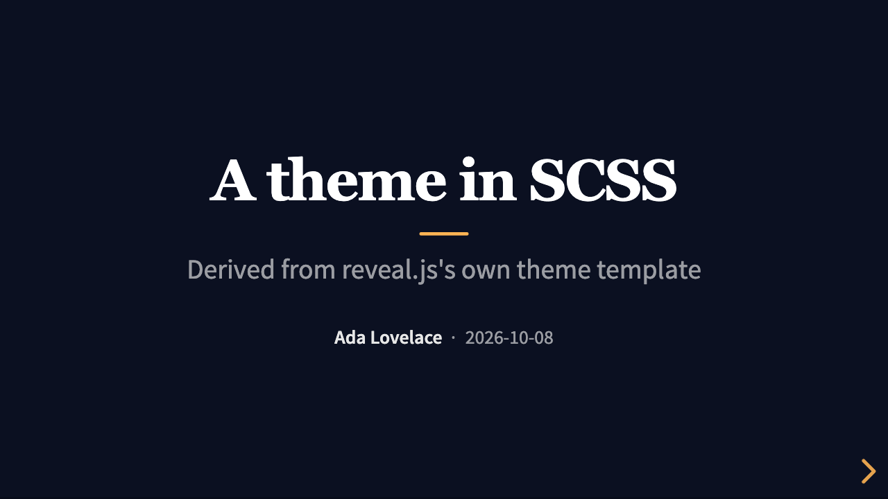

# Themes

A theme is a directory of ordinary files: a `theme.toml`, stylesheets (CSS or SCSS),
templates (Jinja syntax) and assets such as fonts and logos. The built-in theme is called
`default`. Your own theme usually *extends* it and holds only what it changes, and while
`presenter serve` runs, every save of a theme file shows up in the browser.

Start small and go further only when you need to:

1. Change a few [tokens](#tokens) (CSS custom properties) in a child theme's stylesheet.
2. Add CSS rules, or a [layout](#layouts).
3. Override [templates](#templates).
4. [Eject](#eject-a-full-copy) the whole built-in theme and edit everything.

## Choose a theme

The first of these that is set wins:

1. `--theme NAME|PATH` on the command line;
2. `theme:` in the deck's front matter;
3. `theme =` under `[deck]` in `presenter.toml`;
4. `default`.

A value is a built-in theme name or a directory containing a `theme.toml`. A relative
directory is looked up next to `presenter.toml`, then next to the deck, then in the
current directory.

```sh
presenter theme list
```

```text
Built-in themes:
  default  Built-in presenter theme: reveal's white colours, system fonts, top-aligned slides, styled code, tables, alerts and columns, print rules

Theme 'talk' for this directory ([deck] theme = "theme" in presenter.toml):
  chain: talk → default
    talk     theme
    default  built-in
```

## A theme directory

```
mytheme/
├── theme.toml               the manifest (required)
├── styles/theme.css         stylesheets named in theme.toml (CSS, SCSS or Sass)
├── templates/               templates that replace the parent's files of the same name
│   ├── layouts/quote.html   a layout: one file per layout name
│   └── …                    deck.html, slide.html, block.html, cell.html, partials/
├── assets/                  fonts, images, logos: for url() in CSS and asset() in templates
└── scripts/                 JavaScript files named in theme.toml
```

`presenter theme new ./mytheme` creates the first three, with a `theme.toml` whose optional
keys are commented out. All keys, filled in:

```toml
name = "mytheme"                 # shown in messages and by `presenter theme list`
extends = "default"              # parent: a built-in name or a directory relative to this file
description = "Dark theme for data talks"

[styles]
entries = ["styles/theme.css"]   # compiled in order, after the parent's entries
reveal_theme = "white"           # reveal.js base theme, see below, or "none"
highlight_style = "monokai"      # code colours: "monokai", "zenburn", "none" or a CSS file

[scripts]
entries = []                     # e.g. ["scripts/extra.js"]: run before Reveal.initialize

[reveal]                         # reveal.js defaults for decks with this theme
transition = "fade"

[layouts]                        # documents the layouts in templates/layouts/
quote = "One big quotation"

[vars]                           # free values for templates: theme.vars.accent
accent = "#2a76dd"
```

- `reveal_theme` is one of reveal.js's stock themes: `black`, `white`, `league`, `beige`,
  `night`, `serif`, `simple`, `solarized`, `moon`, `dracula`, `sky`, `blood`,
  `black-contrast`, `white-contrast`, or `none` when your stylesheet provides everything.
  `white`, `black`, `white-contrast` and `black-contrast` carry their fonts, and `dracula`
  and `serif` use system fonts. The others load a Google Font when the deck is online, and
  a standalone build warns `remote-import`.
- A child inherits everything it does not set. Its `styles.entries` and `scripts.entries`
  come after its parent's, so its rules win. `[reveal]` and `[vars]` merge key by key.
- `[reveal]` values sit just above the built-in defaults: `presenter.toml` and front
  matter override them ([Configuration](configuration.md#how-settings-combine)).

`presenter theme check ./mytheme` validates a theme: the manifest, the chain, the entries
and that every template compiles. It exits 1 when it finds a problem.

## Tokens

The built-in theme takes its sizes, colours and spacing from CSS custom properties. Set
them in your stylesheet before you write rules:

```css
/* mytheme/styles/theme.css */
:root {
  --p-accent: color-mix(in oklab, #c2410c 75%, currentColor); /* links, rules, controls */
  --r-main-font: "Iowan Old Style", Georgia, serif;           /* headings follow it */
  --r-heading-color: #1c4e80;
  --p-slide-padding: 48px 72px;
  --p-code-font-size: 0.65em;
}
```

`--r-*` are reveal.js's own variables, `--p-*` the built-in theme's. Colours are derived
from the text colour, so they adapt to `reveal_theme = "black"` and to slides with a dark
`background=`. The full list, with defaults, is in the built-in theme's README:
[tokens](../../assets/themes/default/README.md#tokens),
[notebook cells](../../assets/themes/default/README.md#notebook-cells) and
[print rules](../../assets/themes/default/README.md#print-and-pdf). `presenter theme new`
also writes every token, commented out, into the new `styles/theme.css`.

Dark slides need no extra work: `reveal_theme = "black"` under `[styles]`.

## Layouts

A slide picks a layout with `layout=NAME` ([Writing slides](authoring.md#layouts)); the
theme renders it with `templates/layouts/NAME.html` and gives the `<section>` the class
`layout-NAME`. To add one, write a template that extends the default layout and fills its
two blocks:

```jinja
{# mytheme/templates/layouts/quote.html #}

 center
```

```css
/* mytheme/styles/theme.css */
.reveal .layout-quote p {
  font-size: 1.6em;
  font-style: italic;
}
```

```markdown
--- {layout=quote}

Simplicity is prerequisite for reliability.
```

`block layout_classes` adds classes to the `<section>`; `block content` (not used here)
replaces what goes inside it. List the layout under `[layouts]` in `theme.toml` so others
know it exists. `presenter check` warns about a `layout=` that no theme in the chain has.

### The title slide's logo

The `title` layout shows a logo when the front matter sets `logo:` or the theme's
`theme.toml` sets `logo` under `[vars]`. The value names a file in a theme's `assets/`
directory: `logo: logo.svg` finds `mytheme/assets/logo.svg`. `logo: false` in the front
matter hides a theme's logo. A logo file next to the deck does not work
([Not yet](README.md#not-yet)); put it in your theme's `assets/`, or show it with
`` on the slide.

## Extend a theme

```sh
presenter theme new ./mytheme
presenter serve slides.md --theme ./mytheme
```

To use it without the flag, set it in `presenter.toml`:

```toml
[deck]
theme = "./mytheme"
```

`presenter init` already creates such a child theme in `theme/`, with one changed layout
and a few tokens.

To replace one of the parent's files, put a file with the same path in your theme's
`templates/`. To change it rather than replace it, extend the parent's version by its
`@<theme>/` name and call `super()`:

```jinja
{# mytheme/templates/layouts/title.html: the default title slide plus one line #}


{{- super() }}

<p class="event">{{ meta.vars.event }}</p>


```

A plain `` would find this very file again; the
`@default/` prefix reads the default theme's file.

A theme can extend another theme directory (`extends = "../base"`); a chain holds at most
eight themes.

## Eject a full copy

```sh
presenter theme eject default ./mytheme-full
```

copies every file of the built-in theme, with its README, into a theme that extends
nothing. Edit anything; nothing comes from the built-in theme any more, so you also do
not get its later fixes. `presenter init --full-theme` does the same for a new
presentation. Ejecting is also the easiest way to read the built-in templates.

## SCSS

`[styles] entries` may name `.scss` or `.sass` files. presenter compiles them itself (with
the Dart-Sass-compatible grass compiler built into the binary), and it ships reveal.js's
theme template, so you can derive a theme the way reveal's own themes are written:

```scss
// mytheme/styles/theme.scss   (theme.toml: entries = ["styles/theme.scss"], reveal_theme = "none")
@use "reveal/theme/template/settings" with (
  $background-color: #0b1021,
  $main-color: #e6e6e6,
  $heading-font: "Georgia, serif",
  $heading-text-transform: none,
  $link-color: #ffb454
);
@use "reveal/theme/template/theme";
@use "reveal/theme/template/mixins";

.reveal strong { color: #ffb454; }
```



- `@use "palette"` finds `_palette.scss` next to the file, then in the `styles/` of each
  theme in the chain. `reveal/…` names reveal.js's Sass sources (`reveal/theme/white` is a
  stock theme). Sass cannot read other files on the disk.
- CSS imports of local files (`@import url("reveal/theme/fonts/source-sans-pro/source-sans-pro.css")`)
  are inlined, fonts included, so a standalone deck still needs no network.
- Set `reveal_theme = "none"` when the SCSS builds the whole reveal theme.
- Errors name the file, line and column. A compilation that takes longer than 10 seconds
  is stopped and reported as an error.

[`examples/custom-theme-scss`](../../examples/custom-theme-scss/README.md) is a complete
example, and the built-in theme's README has the [details](../../assets/themes/default/README.md#scss):
what Sass can load, how `url()`s resolve and how imports are inlined.

## Templates

Templates use [minijinja](https://docs.rs/minijinja), which follows Jinja2. The built-in
theme has:

| Template | Renders |
|---|---|
| `deck.html` | the document; blocks `head`, `styles`, `body_start`, `slides`, `scripts`, `body_end` |
| `slide.html` | one slide or a vertical stack; picks each slide's layout |
| `layouts/<name>.html` | one `<section>`: `default`, `title`, `section`, `blank` |
| `block.html` | one content block: Markdown HTML, or a notebook cell through `cell.html` |
| `cell.html` | a notebook code cell with its outputs |
| `partials/head.html`, `partials/scripts.html`, `partials/logo.html` | pieces included by the others |

To add something to every page, override a block of `deck.html`:

```jinja
{# mytheme/templates/deck.html #}


<footer class="deck-footer">{{ meta.title }} · {{ meta.vars.venue }}</footer>

```

### What templates receive

```sh
presenter dump slides.md --context > context.json
```

prints exactly the data the templates get, with your theme and configuration applied:

| Key | Holds |
|---|---|
| `meta` | `title`, `subtitle`, `author`, `date`, `description`, `lang`, `theme`, `reveal`, and `vars`: every other front matter key |
| `slides` | the slides: `id`, `layout`, `layout_template`, `classes`, `attrs`, `title`, `blocks`, `notes`, `children`, and `span`: where the slide is in the source (`start_line`, `end_line`, and `cell` for a notebook) |
| `features` | `math`, `code`, `notes`, `notebook`: what the deck uses |
| `config` | the effective [configuration](configuration.md) (`config.notebook.show_prompts`, …) |
| `reveal` | `config_json` (the merged reveal options), `plugins`, `plugin_scripts` |
| `theme` | `name`, `chain`, `reveal_theme`, `highlight_style`, `scripts`, and `vars` from `[vars]` |
| `build` | `mode` (`build` or `serve`), `standalone`, `live_reload`, `version`, and `id`: `presenter serve`'s rebuild counter (`0` in `presenter build`), e.g. to tell rebuilds apart |
| `deck` | the deck as `presenter dump slides.md` prints it: `meta`, `slides`, `features`, `source` (the file), `assets` |

A block is `{"type": "html", "html": "…"}` (insert it with `|safe`) or a notebook cell
(`type` `cell`: `source`, `language`, `outputs`, `hide_input`, …; see the theme README's
[notebook cells](../../assets/themes/default/README.md#notebook-cells)).

Functions and filters for templates:

| Name | Does |
|---|---|
| `style(path)`, `script(path)` | a stylesheet or script, inlined in a standalone build, linked otherwise |
| `asset(path)` | the URL of a file (a `data:` URI in a standalone build) |
| `theme_style()` | the compiled theme stylesheet; keep it the last stylesheet in `<head>` |
| `reveal_init()` | the `Reveal.initialize(…)` call with the merged options and plugins |
| `live_reload()` | the live-reload script while serving; nothing in a build |
| `\|markdown` | renders a string as Markdown (a single paragraph comes without its `<p>`) |
| `\|attrs` | writes a map as ` key="value"` attributes |
| `\|json` | the value as JSON |

`path` is `vendor/…` (reveal.js and KaTeX files), a file in a theme's `assets/`, or
`@<theme>/<path>` relative to that theme's directory. Templates have no clock: the same
input always gives the same output.

## The live-reload loop

```sh
presenter serve slides.md --theme ./mytheme
```

| You save | The browser |
|---|---|
| a stylesheet (`.css`, `.scss`, `.sass`), or a font or image it uses | swaps the theme stylesheet in place: no reload, same slide, same fragment |
| the deck, an image, a template, `theme.toml`, `presenter.toml` | replaces the slides and stays on the current slide |
| something that does not build | keeps the last good deck and shows the error in an overlay, with file, line and the offending source; it goes away with the next good build |

Errors also go to the terminal. Template errors name the template and line, the chain of
includes, and the variables involved:

```text
error: template 'layouts/title.html' line 13: unknown filter: filter upcase is unknown (via slide.html line 21, deck.html line 37)
```

A script added through `[scripts] entries` is not reloaded with the stylesheet; reload the
page after changing one.

## Security

Building a deck runs its theme's templates, and the result runs in the browser of anyone
who opens it:

- A theme's templates and scripts can put any HTML and JavaScript into the deck. A
  notebook's HTML outputs, and raw HTML in Markdown, are inserted as they are, scripts
  included. **Build only themes and notebooks you trust.**
- A theme reads only its own files: a symbolic link from a theme to a file outside it is
  ignored (and `presenter check` warns), so a downloaded theme cannot pull other files from
  your disk into a deck. Notebook outputs embed only files inside the notebook's directory.
- `presenter serve` listens on `127.0.0.1` and answers only requests addressed to
  `localhost`, `127.0.0.1`, `[::1]` or the `--host` you gave (others get `403 Forbidden`), so
  web pages cannot read your deck through DNS tricks. `--host 0.0.0.0` makes it reachable
  from your network: use that only on a network you trust.
