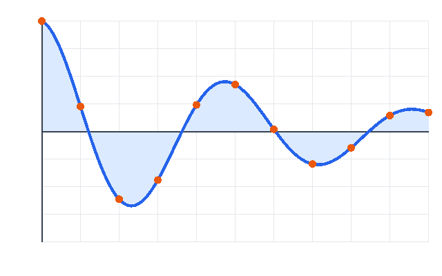

# Presenter basics {layout=title}

:::notes
The title slide uses `layout=title`: the theme adds the subtitle, author and date from the
front matter under the heading.
:::

---

## What this deck shows

- A **title slide** with the subtitle, author and date from the front matter
- A **vertical stack**, **fragments** and **two columns**
- **Code** with line stepping, **math**, a **figure** and a **table**
- A **footnote**, **callouts** and **quotes**
- **Backgrounds**, a **full-slide figure**, an **embedded page** and **speaker notes**

Press <kbd>S</kbd> for the speaker view and <kbd>Esc</kbd> for the overview.

:::notes
Speaker notes go in a `:::notes` block anywhere on the slide. They show up in the speaker
view (press S), never on the slide itself.
:::

---

## A vertical stack

A line with just `--` starts a slide *below* the current one.

Press <kbd>↓</kbd> to go down the stack.

--

## One level down {#stack-child}

This slide has the id `stack-child` (written `{#stack-child}` after the heading), so
[a link to `#/stack-child`](#/stack-child) jumps straight here.

--

## The bottom of the stack

Press <kbd>→</kbd> to leave the stack, or <kbd>↑</kbd> to go back up.

---

## Fragments

:::fragment index=1
**First click:** a plain fragment fades in.
:::

:::fragment fade-up index=3
**Third click:** written second, but `index=3` shows it last.
:::

:::fragment highlight-blue index=2
**Second click:** `highlight-blue` turns this paragraph blue.
:::

Fragments can also be raw HTML, inline:
<span class="fragment highlight-red" data-fragment-index="4">the fourth click</span>.

---

## Two columns

::::columns widths="2fr 3fr"
:::column
The figure is a local file, `figures/plot.png`.

A standalone build inlines it; a site build copies it to `assets/`.
:::
:::column

:::
::::

---

## Code with line stepping

```python {lines="1|3-4|6-7"}
import math

def area(radius):
    return math.pi * radius ** 2

for r in (1, 2, 3):
    print(f"r = {r}: area = {area(r):.2f}")
```

Each click highlights the next group of lines.

:::notes
The fence is written as `python {lines="1|3-4|6-7"}`.
:::

---

## Math

Inline math sits in the text: a circle of radius $r$ has the area $A = \pi r^2$, and
Euler's identity reads $e^{i\pi} + 1 = 0$.

Display math gets a line of its own:

$$\int_0^\infty e^{-x^2} dx = \frac{\sqrt{\pi}}{2}$$

---

## A table

| Line | Starts | Use it for |
|:--|:--|:--|
| `---` | a horizontal slide | the next topic |
| `--` | a vertical slide | details of the current topic |
| `--- {…}` | a slide with attributes | backgrounds, transitions, layouts |

---

## A footnote

presenter renders slides with reveal.js[^reveal] and math with KaTeX[^katex].
Both are bundled, so this deck works offline.

[^reveal]: reveal.js 6.0.2, <https://revealjs.com>
[^katex]: KaTeX 0.19.0, <https://katex.org>

---

## Callouts and quotes

> [!TIP]
> GitHub-style alerts start with `[!NOTE]`, `[!TIP]`, `[!IMPORTANT]`, `[!WARNING]` or
> `[!CAUTION]` on the first line of a block quote.

> A plain block quote sets a remark or a citation apart.

:::small
`:::small` and `:::large` blocks change the text size; `:::center` centres one.
:::

--- {background="#0f172a" transition=zoom}

## Backgrounds

This slide starts with `--- {background="#0f172a" transition=zoom}`.

A colour sets the slide's background colour, a file name its background image.

--- {background=figures/plot.png background-size=contain background-opacity=0.2}

## Background images

The figure behind this text is `figures/plot.png`, drawn at 20% opacity.

--- {layout=blank}


:::notes
`--- {layout=blank}` drops the slide padding, so a lone image, video or iframe fills the
whole slide.
:::

---

## Raw HTML: an embedded page

<iframe src="figures/embed.html" width="900" height="360" title="An embedded local page"></iframe>

Raw HTML passes through unchanged, except that local `src` files are bundled like images.

---

# Thank you {layout=section}

Build this deck with `presenter build examples/basic/slides.md`.
