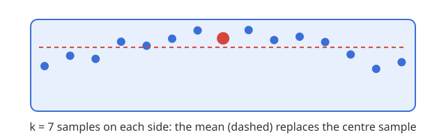

## A centred window {#window}

Each point is the mean of its window, so the first and last $k$ points have none.

---

## Takeaways

- A rolling mean is a low-pass filter: it keeps the slow signal and drops the fast noise
- A wider window removes more noise and flattens the peaks more
- Centre the window when the whole series is known; use a trailing one for live data
